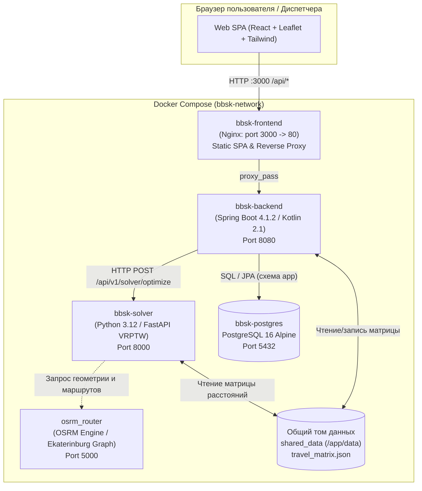

# BBSK.C5D — Интеллектуальная система диспетчеризации и оптимизации работы выездных специалистов

> **UISI Hackathon (Хакатон ЮУрГУ) — Кейс №5 «Ростелеком»**  
> **Команда:** «Бубышки» (BBSK)  
> **Версия системы:** `1.0.0`

### Состав команды
- Деулин А.Л. ПЕ-31б (Ar4ikoffc)
- Крикунов О.Д. ИТ-32б (poppurindayo)
- Кочуров А.А. ИТ-32б (cotonetrash)
- Симаков Г.О. ИТ-32б (uzer2232)
- Сидоров А.О. ИТ-32б

---

## Оглавление

1. [Описание системы и решаемая задача](#описание-системы-и-решаемая-задача)
2. [Архитектура системы](#архитектура-системы)
3. [Стек технологий](#стек-технологий)
4. [Движок оптимизации маршрутов (VRPTW Solver)](#движок-оптимизации-маршрутов-vrptw-solver)
5. [Возможности веб-интерфейса диспетчера](#возможности-веб-интерфейса-диспетчера)
6. [Конфигурация окружения (.env)](#конфигурация-окружения-env)
7. [Быстрый запуск в Docker Compose](#быстрый-запуск-в-docker-compose)
8. [Точки входа и адреса сервисов](#точки-входа-и-адреса-сервисов)
9. [Наполнение базы тестовыми данными (Seed Data)](#наполнение-базы-тестовыми-данными-seed-data)
10. [Автоматическое сквозное тестирование API](#автоматическое-сквозное-тестирование-api)
11. [Локальный запуск без контейнеризации (Dev-режим)](#локальный-запуск-без-контейнеризации-dev-режим)
12. [Спецификация и документация API](#спецификация-и-документация-api)

---

## Описание системы и решаемая задача

**BBSK.C5D** — аппаратно-программный комплекс оперативного планирования, автоматического распределения нарядов и реактивной диспетчеризации выездных инженеров ПАО «Ростелеком».

Система решает класс задач многодеповой маршрутизации с временными окнами и ресурсными ограничениями (**Multi-Depot VRPTW with Time Windows, Skills & Capacity Constraints**):

- **Суточное планирование:** формирование оптимальных маршрутов и графиков выездов бригад с учетом квалификации сотрудников, топологии сети (PON, FTTB), наличия оборудования в багажнике, дорожной ситуации и тайм-слотов абонентов.
- **Соблюдение трудовых нормативов:** автоматическое планирование сменных перерывов на обед строго продолжительностью 60 минут в разрешенном интервале, учет времени старта/окончания смены и обязательного возврата в базовый сервисный центр.
- **Управление абонентским оборудованием (АО):** контроль расхода роутеров, оптических терминалов (ONT) и ТВ-приставок (STB), автоматическое включение заездов на склад (депо) для пополнения запасов (`RESTOCK`).
- **Реактивное перепланирование в реальном времени (Event-Driven):** мгновенная адаптация расписания при возникновении внешних инцидентов (отмена наряда абонентом, появление срочной заявки, сход инженера с линии по болезни или поломке авто, задержка выполнения работ на объекте) с сохранением уже выполненных или находящихся в работе этапов (`frozen_stops`).

---

## Архитектура системы

Комплекс построен по сервисно-ориентированной микросервисной архитектуре и разворачивается в 5 изолированных контейнерах, объединенных внутренней виртуальной сетью `bbsk-network`:



### Назначение компонентов:

1. **`bbsk-frontend` (Port 3000):** Клиентский интерфейс диспетчера на базе Nginx и React 18 SPA. Обеспечивает отображение интерактивной карты города, таймлайнов бригад, управление нарядами, симуляцию событий и визуальный генератор тестовых данных.
2. **`bbsk-backend` (Port 8080):** Центральное ядро бизнес-логики на Kotlin и Spring Boot. Обрабатывает аутентификацию (JWT в HttpOnly cookie), CRUD-операции сущностей, применение миграций схемы БД (Flyway), управление рабочими днями и координацию перепланирования.
3. **`bbsk-solver` (Port 8000):** Математический микросервис оптимизации на Python 3.12 / FastAPI. Реализует эвристические алгоритмы пространственно-временной кластеризации, 2-Opt локального поиска и временного менеджмента.
4. **`osrm_router` (Port 5000):** Высокопроизводительный движок маршрутизации Open Source Routing Machine на реальном дорожном графе г. Екатеринбурга (алгоритм MLD).
5. **`bbsk-postgres` (Port 5432):** Реляционная база данных PostgreSQL 16. Изолированная схема `app`, транзакционная надежность, хранение истории событий и геопривязок.
6. **`shared_data` (Docker Volume):** Общее файловое хранилище между бэкендом и солвером для обмена матрицами времен перемещений (`travel_matrix.json`).

---

## Стек технологий

### Backend & Core
- **Язык:** Kotlin 2.1 (JVM 21 / Eclipse Temurin 21)
- **Фреймворк:** Spring Boot 4.1.2 (Spring Web MVC, Spring Data JPA, Spring Security)
- **База данных:** PostgreSQL 16 Alpine
- **Миграции БД:** Flyway (схема `app`)
- **Безопасность:** JWT (JJWT 0.12.6) с передачей токена в защищенной `HttpOnly` cookie
- **Сериализация данных:** Jackson + `jackson-datatype-jsr310` (OffsetDateTime / ISO 8601)
- **Документация API:** SpringDoc OpenAPI 3.2.0 (Swagger UI) + Redoc
- **Сборка:** Gradle 9.8.2 Wrapper

### VRPTW Solver & Routing
- **Язык & Фреймворк:** Python 3.12, FastAPI, Uvicorn, Pydantic v2
- **Алгоритмы:** Эвристическая вставка с минимизацией задержек (Greedy Insertion), 2-Opt локальный поиск, динамический расчет таймлайна с временными окнами и емкостью
- **Картография & Маршрутизация:** OSRM (Open Source Routing Machine), OSM PBF (граф дорог Екатеринбурга)

### Frontend (Dispatcher Web UI)
- **Библиотека / Язык:** React 18, TypeScript 5.6
- **Сборщик:** Vite 5.4
- **Стилизация & UI:** Tailwind CSS, Radix UI Primitives, Lucide Icons, class-variance-authority
- **Геокартография:** Leaflet 1.9, React-Leaflet
- **Стейт-менеджмент & Запросы:** Zustand, TanStack React Query v5, Axios
- **Аналитика и графики:** Recharts, date-fns

---

## Движок оптимизации маршрутов (VRPTW Solver)

Оптимизатор решает задачу распределения нарядов с жесткими (Hard) и мягкими (Soft) ограничениями за минимальное процессорное время (< 100 мс на суточный пул нарядов).

### Конвейер решения задачи:

1. **Hard Feasibility Filter (H1 — Допуски и компетенции):**  
   Отбор квалифицированных инженеров для каждого наряда:
   - Профиль специалиста: `INSTALL` (подключения), `LTP3` (устранение сложных аварий), комбинированный.
   - Поддерживаемые технологии: `PON`, `FTTB`, `DOCSIS`.
   - Допуск к работам на высоте: обязателен для частного сектора и домов с воздушными линиями связи (`overhead_line = true`).
2. **Приоритизация пула нарядов:**  
   - Повторные наряды (с признаком `repeated = true`) получают удвоенный весовой коэффициент ($x2$).
   - Учет жестких SLA: аварийные ремонты (`REPAIR`) с дедлайнами 12 ч / 24 ч приоритизируются относительно стандартных инсталляций.
   - Ранжирование по временным окнам абонентов.
3. **Пространственно-временная вставка по дорожной сети:**  
   Поиск оптимального инженера и позиции вставки в маршрут на основе матрицы времени перемещений между депо и зданиями с минимизацией холостого пробега.
4. **Локальный поиск 2-Opt:**  
   Оптимизация порядка объезда точек внутри каждого сформированного маршрута для устранения перекрестных переездов.
5. **Движок таймлайна (Timeline Manager):**
   - Формирование обязательного стопа `BREAK` (обед ровно 60 минут) в заданном интервале смены (H3).
   - Моделирование остатков оборудования в багажнике инженера. При нехватке роутеров/ONT планируется заезд в ближайший сервисный центр (`RESTOCK`, H7).
   - Обязательный возврат в базовый сервисный центр до завершения рабочей смены (`DEPOT_END`, H4).
6. **Механизм заморозки стопов (`frozen_stops`):**  
   При реактивных событиях в течение дня точки маршрута, завершенные или выполняемые на текущий момент времени (`now`), фиксируются как неизменяемые. Солвер оптимизирует только будущий хвост дня.
7. **Гарантия уникальности (H9):**  
   Каждый заказ либо назначается ровно одному инженеру, либо попадает в список необслуженных (`unassigned_orders`) с явной причиной (`NO_QUALIFIED_STAFF`, `TIME_LIMIT_EXCEEDED`, `CAPACITY_EXCEEDED`).

---

## Возможности веб-интерфейса диспетчера

Веб-приложение диспетчера доступно в браузере по адресу `http://localhost:3000` и включает в себя:

- **Дашборд мониторинга (Dashboard):** Сводная статистика смены, KPI выездных инженеров, количество закрытых нарядов, уровень утилизации рабочего времени и график выполнения работ.
- **Интерактивная карта (Map View):** Полноэкранная карта Екатеринбурга на базе Leaflet с отображением сервисных центров (депо), узлов доступа (OLT / Switch), зданий (МКД и частный сектор), а также цветовой дифференциацией треков движения инженеров.
- **Суточное планирование (Day Planning):**
  - Выбор целевой даты смены.
  - Запуск построения суточного плана в один клик (`POST /plan`).
  - Интерактивные визуальные таймлайны инженеров со стопами: `DEPOT_START` ➔ `VISIT` ➔ `BREAK` ➔ `RESTOCK` ➔ `DEPOT_END`.
  - Просмотр метрик суммарного пробега и затраченного времени.
- **Реестр нарядов (Orders):** Полнофункциональная таблица заказов с фильтрацией по статусам (`PENDING`, `SCHEDULED`, `IN_PROGRESS`, `DONE`, `CANCELLED`), типам работ (`INSTALL`, `REPAIR`), поиском по адресам и клиентам.
- **События смены (Events):** Панель оперативной диспетчеризации. Позволяет симулировать и регистрировать события реального времени (`ORDER_CANCELLED`, `NEW_ORDER`, `STAFF_UNAVAILABLE`, `VISIT_DELAYED`, `TIME_TICK`) с визуализацией мгновенного перестроения графиков.
- **Управление персоналом (Staff):** Список выездных специалистов, графики смен, привязка к депо, статус допуска на высоту и остатки оборудования в багажнике.
- **Управление инфраструктурой (Buildings & Topology):** Каталог зданий с типами (МКД, частный сектор), признаком ВЛС и привязкой к узлам доступа и сервисным центрам.
- **Мастер тестовых данных (Data Wizard в админке):** Удобный мастер в UI для генерации, редактирования и пакетной отправки демонстрационных наборов данных в БД в один клик.

---

## Конфигурация окружения (.env)

Настройка параметров производится через переменные окружения в файле `.env` в корне проекта.

### Шаблон переменных (`.env.example`):

```bash
# Параметры подключения к СУБД PostgreSQL
POSTGRES_SERVER=postgres
POSTGRES_PORT=5432
POSTGRES_USER=postgres
POSTGRES_PASSWORD=postgres
POSTGRES_DB=rostelecom
POSTGRES_SCHEMA=app

# Порт бэкенд HTTP-сервера
SERVER_PORT=8080

# URL сервиса оптимизации (VRPTW Solver)
SOLVER_URL=http://solver:8000

# Путь к файлу дорожной матрицы в общем Docker томе
TRAVEL_MATRIX_FILE_PATH=/app/data/travel_matrix.json

# Секретный ключ для подписи JWT-токенов (при отсутствии генерируется автоматически)
SECRET_KEY=j0EyOUf_Tv16PwXbnhfpTOG_ScYic7776ipGXqijXyA
```

---

## Быстрый запуск в Docker Compose

### 1. Системные требования
- **Docker Engine** версии 24.0 или выше.
- **Docker Compose** версии 2.20 или выше.
- Свободные порты на хост-машине: `3000`, `8080`, `8000`, `5000`, `5432`.

### 2. Подготовка конфигурации

Скопируйте пример файла окружения:

- **Linux / macOS:**
  ```bash
  cp .env.example .env
  ```
- **Windows (PowerShell):**
  ```powershell
  Copy-Item .env.example .env
  ```

### 3. Сборка и запуск контейнеров

Запустите сборку и старт всех сервисов в фоновом режиме:

```bash
docker compose up -d --build
```

Compose автоматически выполнит:
1. Запуск СУБД `bbsk-postgres` и прохождение проверки готовности (`pg_isready`).
2. Запуск солвера `bbsk-solver` и OSRM-маршрутизатора `osrm_router`.
3. Сборку и старт бэкенда `bbsk-backend` с автоматическим накатыванием миграций Flyway.
4. Сборку продакшн-образа фронтенда `bbsk-frontend` (Node 20 + Nginx).

### 4. Управление и мониторинг

- **Проверка статуса всех контейнеров:**
  ```bash
  docker compose ps
  ```
- **Просмотр логов всех сервисов:**
  ```bash
  docker compose logs -f
  ```
- **Логи конкретного сервиса:**
  ```bash
  docker compose logs -f backend
  docker compose logs -f solver
  docker compose logs -f frontend
  ```
- **Остановка сервисов:**
  ```bash
  docker compose down
  ```
- **Остановка с очисткой данных БД и томов:**
  ```bash
  docker compose down -v
  ```

---

## Точки входа и адреса сервисов

| Сервис / Точка входа | Протокол и URL | Описание |
| :--- | :--- | :--- |
| **Веб-интерфейс диспетчера** | [http://localhost:3000](http://localhost:3000) | Рабочее место диспетчера (React SPA) |
| **Backend API Healthcheck** | [http://localhost:8080/api/v1/health](http://localhost:8080/api/v1/health) | Проверка готовности бэкенда |
| **Swagger UI (Интерактивная дока)** | [http://localhost:8080/swagger-ui.html](http://localhost:8080/swagger-ui.html) | Интерактивное тестирование всех API |
| **OpenAPI Spec (JSON)** | [http://localhost:8080/v3/api-docs](http://localhost:8080/v3/api-docs) | Спецификация OpenAPI 3.0 в формате JSON |
| **OpenAPI Spec (YAML)** | [http://localhost:8080/v3/api-docs.yaml](http://localhost:8080/v3/api-docs.yaml) | Спецификация OpenAPI 3.0 в YAML |
| **Автономный Redoc (без Docker)** | [docs/index.html](file:///d:/Projects/bbsk.c5d/docs/index.html) | Локальный Redoc-просмотрщик в браузере |
| **VRPTW Solver API** | [http://localhost:8000/docs](http://localhost:8000/docs) | Swagger документация микросервиса солвера |
| **OSRM Engine** | [http://localhost:5000](http://localhost:5000) | Движок гео-маршрутизации |

---

## Наполнение базы тестовыми данными (Seed Data)

Для полноценной демонстрации работы системы предусмотрено несколько простых способов наполнения базы тестовыми сущностями (сервисные центры, узлы доступа, здания, сотрудники, графики смен, матрица расстояний, наряды на тестовую дату `2026-10-26`).

### Вариант 1: Через веб-интерфейс (Рекомендуемый)
1. Откройте в браузере [http://localhost:3000](http://localhost:3000).
2. Перейдите в раздел **Администрирование** (`/admin`).
3. Нажмите кнопку **«Генератор тестовых данных»** (TestDataWizard).
4. Нажмите **«Загрузить справочники и матрицу»** — данные будут автоматически записаны в БД.

### Вариант 2: Запуск консольного скрипта `seed_data.py`
В репозитории подготовлен готовый Python-скрипт сидинга:

```bash
python seed_data.py
```

Скрипт пошагово выполнит:
1. Проверку доступности бэкенда (`GET /api/v1/health`).
2. Пакетную заливку справочников через `PUT /api/v1/reference` (депо `SC-01`, `SC-02`, узлы `AN-001`, `AN-002`, дома `B-001`..`B-004`, бригады `TECH-01`..`TECH-03`, смены и типы работ).
3. Запись матрицы перемещений 6×6 через `PUT /api/v1/reference/travel-matrix`.
4. Инициализацию рабочего дня `2026-10-26` с нарядами через `PUT /api/v1/days/2026-10-26`.
5. Автоматический запуск расчета суточного плана через `POST /api/v1/days/2026-10-26/plan`.

---

## Автоматическое сквозное тестирование API

Для полной верификации бизнес-логики и контракта API разработан автоматический тестовый набор `test_suite.py`, покрывающий **50 сквозных тест-кейсов**:

```bash
python test_suite.py
```

### Структура тестов:
- **Служебные методы:** `GET /api/v1/health`.
- **Аутентификация и безопасность:** `POST /api/auth/register`, `POST /api/auth/login`, `GET /api/auth/me` (с cookie и без для проверки 401), `POST /api/auth/logout`.
- **Справочники (Bulk API):** `PUT /api/v1/reference`, `PUT /api/v1/reference/travel-matrix`.
- **CRUD инфраструктуры и сущностей:** Сервисные центры, узлы доступа, здания, типы работ, сотрудники, смены.
- **Суточные графики и заказы:** `PUT /api/v1/days/{date}`, CRUD нарядов (`/api/v1/orders`).
- **VRPTW Оптимизация:** `POST /api/v1/days/{date}/plan`, `GET /api/v1/days/{date}/plan`.
- **Обработка реактивных событий:** `POST /api/v1/days/{date}/events` (`ORDER_CANCELLED`, `NEW_ORDER`, `STAFF_UNAVAILABLE`).
- **Валидация и негативные сценарии:** проверка кодов `400 Bad Request`, `404 Not Found`.

Подробный отчет о прохождении тестов зафиксирован в файле [TEST.md](file:///d:/Projects/bbsk.c5d/TEST.md).

---

## Локальный запуск без контейнеризации (Dev-режим)

Если требуется модифицировать код с поддержкой горячей перезагрузки (Hot Reload), сервисы можно запустить локально.

### 1. Запуск СУБД PostgreSQL в Docker
```bash
docker compose up -d postgres
```
*(База данных доступна на `localhost:5432`)*

### 2. Запуск Backend (Spring Boot)
Перейдите в директорию `back`:
- **Linux / macOS:**
  ```bash
  cd back
  ./gradlew bootRun
  ```
- **Windows (PowerShell / CMD):**
  ```powershell
  cd back
  .\gradlew.bat bootRun
  ```

### 3. Запуск VRPTW Solver (FastAPI)
Перейдите в директорию `map-module`:
```bash
cd map-module
python -m venv .venv
# Активация виртуального окружения:
# Windows: .venv\Scripts\activate
# Linux/macOS: source .venv/bin/activate
pip install -r requirements.txt
python -m uvicorn main:app --host 0.0.0.0 --port 8000 --reload
```

### 4. Запуск Frontend (Vite Dev Server)
Перейдите в директорию `front`:
```bash
cd front
npm install
npm run dev
```
Фронтенд будет доступен по адресу `http://localhost:5173` с автоматическим проксированием запросов на бэкенд.

---

## Спецификация и документация API

Подробная документация всех эндпоинтов REST API доступна в следующих форматах:

- **Полное руководство по API:** [docs/API.md](file:///d:/Projects/bbsk.c5d/docs/API.md) — детальное описание структур запросов/ответов, правил валидации и бизнес-логики.
- **Спецификация OpenAPI 3.0 (YAML):** [docs/openapi.yaml](file:///d:/Projects/bbsk.c5d/docs/openapi.yaml) — файл спецификации для импорта в Swagger Editor, Postman, Insomnia.
- **Автономный Redoc HTML:** [docs/index.html](file:///d:/Projects/bbsk.c5d/docs/index.html) — готовый HTML-файл интерактивной документации, открывающийся локально в любом веб-браузере без необходимости запускать сервера.

### Сводная таблица групп эндпоинтов

| Группа API | Базовый путь | Описание |
| :--- | :--- | :--- |
| **Health** | `/api/v1/health` | Проверка готовности сервиса к работе |
| **Auth** | `/api/auth` | Регистрация, авторизация, текущая сессия, выход |
| **Reference** | `/api/v1/reference` | Пакетная загрузка всех справочников и матрицы дорожной сети |
| **Staff & Shifts** | `/api/v1/staff` | Управление выездными инженерами и графиками смен |
| **Infrastructure** | `/api/v1/buildings` | Здания, сервисные центры (депо) и узлы доступа |
| **Work Types** | `/api/v1/work-types` | Нормативы типов работ (`INSTALL`, `REPAIR`, `SERVICE` и др.) |
| **Days & Plans** | `/api/v1/days/{date}` | Инициализация рабочего дня, запуск построения плана и маршрутов |
| **Orders** | `/api/v1/orders` | Реестр нарядов на выполнение работ |
| **Events** | `/api/v1/days/{date}/events` | Регистрация оперативных событий с перепланированием |
| **Solver** | `/api/v1/solver/optimize` | Прямой вызов микросервиса оптимизации VRPTW (порт 8000) |