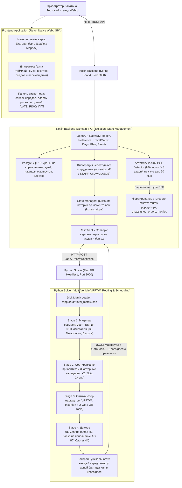
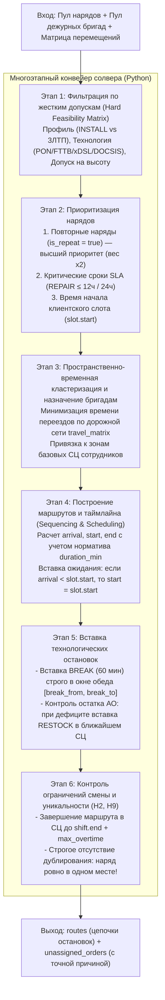

# Архитектурная и алгоритмическая спецификация: MVP Rostelecom Field Force VRPTW

**Кейс:** №05 «Умная диспетчеризация выездных бригад» (Всероссийский хакатон связи 2026, ПАО «Ростелеком», г. Екатеринбург).  
**Цель системы:** Автоматическое распределение нарядов между выездными инженерами (бригадами) и оптимизация маршрутов на смену с динамическим перепланированием при онлайн-событиях.

---

## 1. Концепция и Архитектурное Разделение Ролей

С учетом взаимного влияния времени перемещения по дорожной сети ($travel\_time$), исчерпания запаса абонентского оборудования (АО), обязательного обеденного перерыва (60 мин) и жестких временных окон абонентов (слоты 2 часа), **полная задача распределения нарядов по сотрудникам и оптимизации маршрутов делегирована Python Solver**.



---

## 2. Предметная Область и Параметры Задачи (по ТЗ Ростелеком)

### 2.1. Потоки работ и профили сотрудников
В системе 40 выездных сотрудников двух ключевых профилей:
* **28 сотрудников профиля `3ЛТП` (`LTP3`):** третья линия технической поддержки — восстановление услуг, устранение аварий и деградаций, демонтаж оборудования.
* **12 сотрудников профиля `Инсталляция` (`INSTALL`):** подключение услуг новым абонентам (ШПД, IPTV), доподключение сервисов, обследование объектов.

### 2.2. Справочник типов работ, нормативы и сроки (SLA)
Каждый наряд имеет фиксированный норматив времени на выполнение работ на объекте и контрольный срок устранения:

| Код (`code`) | Тип работ | Профиль (`profile`) | Норматив (`duration_min`) | Контрольный срок (SLA) |
|---|---|---|---|---|
| `INST_PON_MKD` | Инсталляция ШПД/IPTV, МКД, PON | `INSTALL` | 90 мин | Визит в согласованный слот; подключение $\le 3$ раб. дней |
| `INST_FTTB_MKD` | Инсталляция ШПД/IPTV, МКД, FTTB | `INSTALL` | 60 мин | Визит в согласованный слот; подключение $\le 3$ раб. дней |
| `INST_PRIVATE_VLS` | Инсталляция, частный сектор, с ВЛС | `INSTALL` + **высота** | 180 мин | Визит в слот; подключение $\le 5$ раб. дней |
| `ADD_SERVICE` | Доподключение услуги (IPTV, Wi-Fi роутер) | `INSTALL` | 40 мин | Визит в согласованный слот |
| `SURVEY_PRIVATE` | Обследование (частный сектор) | `INSTALL` или `3ЛТП` | 45 мин | $\le 2$ рабочих дней |
| `REPAIR` | Устранение неисправности (обращение абонента) | `3ЛТП` | 60 мин | $\le 24$ ч с регистрации; **повторное обращение $\le 12$ ч** |
| `DEGRADATION` | Устранение деградации (мониторинг качества) | `3ЛТП` | 45 мин | $\le 48$ ч с регистрации |
| `DISMANTLE` | Демонтаж АО | `3ЛТП` | 30 мин | $\le 5$ рабочих дней |

### 2.3. Режим работы сотрудников и сервисные центры
* **Смены сотрудников:** `09:00–18:00` или `12:00–21:00`.
* **Обеденный перерыв (H3):** строго 1 час (60 мин), должен быть запланирован внутри разрешенного окна смены (обычно `12:00–15:00` или `15:00–18:00`). Место обеда — совпадает с предыдущей точкой, время на дорогу равно 0.
* **Сервисные центры (5 СЦ в Екатеринбурге):**
  * Каждый сотрудник закреплен за базовым СЦ (`staff.service_center_id`).
  * Маршрут обязан начинаться в базовом СЦ (`DEPOT_START`) и заканчиваться в базовом СЦ (`DEPOT_END`).
  * В начале смены в машине находится стартовый запас АО (`equipment_start`).
* **Пополнение АО (H7, H8):**
  * Абонентское оборудование трех видов: `ONT`, `ROUTER`, `STB`.
  * Если для следующего наряда не хватает запаса в «рюкзаке», алгоритм планирует заезд на пополнение (`RESTOCK`) в **любой СЦ**, открытый в этот интервал времени.
  * Длительность заезда на пополнение $\ge restock\_duration\_min$ (15–20 мин). После пополнения остаток восстанавливается до максимальной вместимости (`equipment_capacity`).

---

## 3. Алгоритм Распределения и Маршрутизации в Python Solver

В солвер передается **весь доступный пул нарядов дня** и **весь пул дежурных сотрудников** (исключая отсутствующих).  
Солвер решает совместную задачу распределения и маршрутизации (Full Multi-Depot VRPTW с гетерогенным флотом и динамическим пополнением запасов):



### 3.1. Этап 1: Фильтрация совместимости (Hard Qualification H1)
Для каждой пары `(сотрудник, наряд)` проверяется жесткая булева матрица допустимости:
$$Valid(staff, order) \iff \Big(order.profiles \cap staff.profiles \neq \emptyset\Big) \wedge \Big(order.technology \in staff.technologies\Big) \wedge \Big(order.requires\_height \implies staff.height\_permit\Big)$$
* **Запрет назначения:** Если хотя бы одно условие ложно, наряд сотруднику **не может быть назначен ни при каких обстоятельствах**.
* **Приоритет квалификации над равномерностью:** Равномерность загрузки сотрудников второстепенна по сравнению с допуском. Если специфической технологией обладают лишь 2 инженера из 40, весь пул соответствующих заказов закрепляется за ними (до исчерпания фонда их смен).

### 3.2. Этап 2: Приоритизация пула нарядов
При формировании порядка распределения наряды ранжируются по взвешенному приоритету:
1. **Повторные обращения (`is_repeat = true`):** наивысший приоритет (в скоринге хакатона имеют вес 2; контрольный срок REPAIR сокращается до 12 часов).
2. **Тип работ и SLA:** аварийные заявки `REPAIR` (24 ч) $\to$ `DEGRADATION` (48 ч) $\to$ плановые инсталляции `INSTALL` (3–5 дней).
3. **Временной слот клиента:** заказы сортируются по возрастанию `slot.start` и `latest_start`.

### 3.3. Этап 3 & 4: Оптимизация маршрутов и расписания (VRPTW Engine)
Солвер использует эвристику последовательной вставки (Time-Oriented Sequential Insertion) с последующим локальным поиском (2-Opt / Relocate / Cross-Exchange) либо модуль OR-Tools Routing:
* **Время перемещения:** берется из предзагруженной матрицы `travel_matrix.json`:
  $$arrival_k = end_{k-1} + travel\_time(building_{k-1}, building_k)$$
* **Соблюдение слота:**
  $$start_k = \max(arrival_k, slot.start_k)$$
  $$start_k \le latest\_start_k \quad \text{и} \quad end_k = start_k + duration\_min_k \le deadline_k$$
* Если инженер прибывает раньше начала слота ($arrival < slot.start$), время до начала слота считается технологическим ожиданием.

### 3.4. Этап 5: Динамическая вставка перерыва (Обед H3) и пополнения АО (H7)
* **Обед (BREAK):** В цепочку остановок каждого инженера, у которого есть хотя бы один визит, алгоритм обязан вставить одну остановку типа `BREAK`:
  - Длительность ровно 60 минут.
  - $start_{BREAK} \ge shift.break\_from$ и $start_{BREAK} \le shift.break\_to - 60 \text{ мин}$.
  - Локация обеда: координаты предыдущей остановки (время в пути 0).
* **Моделирование баланса АО:**
  - Начальный баланс: $balance_0 = staff.equipment\_start$.
  - Перед планированием $k$-го визита проверяется:
    $$\forall t \in \{ONT, ROUTER, STB\}: balance[t] \ge order_k.required[t]$$
  - Если условие нарушено, алгоритм планирует заезд в ближайший работающий сервисный центр (`RESTOCK`):
    - Дорога до СЦ: $travel\_time(location_{k-1}, SC)$.
    - Остановка в СЦ длительностью $\ge restock\_duration\_min$.
    - Пополнение запасов: $balance[t] = staff.equipment\_capacity[t]$.
    - После `RESTOCK` инженер следует к $k$-му наряду.

### 3.5. Этап 6: Гарантия уникальности и возврат нераспределенных нарядов (H9)
* **Абсолютный запрет дублирования:** Каждый наряд дня из входного списка обязан присутствовать **ровно в одном** месте:
  1. В качестве `VISIT` в маршруте ровно одного сотрудника;
  2. В списке групп ПГП (`pgp_groups`);
  3. В списке `unassigned_orders`;
  4. В списке отмененных (`cancelled`).
* **Точные причины нераспределения (`unassigned_orders`):**
  - `NO_QUALIFIED_STAFF` — нет дежурного сотрудника с нужной технологией, профилем или высотным допуском.
  - `SHIFT_EXCEEDED` — смена подходящих сотрудников полностью заполнена, лимит рабочего времени исчерпан.
  - `SLOT_UNFEASIBLE` — невозможно доехать до адреса к началу слота `latest_start` с учетом текущего дорожного трафика.
  - `CAPACITY_EXCEEDED` — исчерпана суточная вместимость оборудования даже с учетом заездов в СЦ.

---

## 4. Контракт Обмена Данными: Kotlin ↔ Python Solver

### Эндпоинт: `POST /api/v1/solver/optimize`

#### 4.1. Входной запрос от Kotlin к Python:
Kotlin передает полный контекст дня:
```json
{
  "date": "2026-10-26",
  "now": "2026-10-26T08:00:00+05:00",
  "service_centers": [
    {
      "id": "SC-01",
      "building_id": "B-00001",
      "open_from": "08:00",
      "open_to": "21:00",
      "restock_duration_min": 20
    }
  ],
  "staff": [
    {
      "staff_id": "ST-001",
      "service_center_id": "SC-01",
      "profiles": ["INSTALL"],
      "technologies": ["PON", "FTTB"],
      "height_permit": true,
      "shift": {
        "start": "09:00",
        "end": "18:00",
        "break_duration_min": 60,
        "break_window": { "from": "12:00", "to": "15:00" }
      },
      "equipment_start": { "ONT": 3, "ROUTER": 4, "STB": 2 },
      "equipment_capacity": { "ONT": 6, "ROUTER": 6, "STB": 4 },
      "frozen_stops": []
    }
  ],
  "orders": [
    {
      "order_id": "ORD-20261026-0001",
      "building_id": "B-00412",
      "work_type": "INST_PON_MKD",
      "profiles": ["INSTALL"],
      "technology": "PON",
      "requires_height": false,
      "duration_min": 90,
      "slot": {
        "start": "2026-10-26T09:00:00+05:00",
        "end": "2026-10-26T11:00:00+05:00"
      },
      "latest_start": "2026-10-26T11:00:00+05:00",
      "deadline": "2026-10-26T18:00:00+05:00",
      "required_equipment": { "ONT": 1, "ROUTER": 1, "STB": 0 },
      "is_repeat": false
    }
  ]
}
```

#### 4.2. Ответ от Python к Kotlin:
```json
{
  "status": "SUCCESS",
  "execution_time_ms": 1450,
  "routes": [
    {
      "staff_id": "ST-001",
      "stops": [
        {
          "seq": 1,
          "type": "DEPOT_START",
          "order_id": null,
          "building_id": "B-00001",
          "arrival": "2026-10-26T09:00:00+05:00",
          "start": "2026-10-26T09:00:00+05:00",
          "end": "2026-10-26T09:00:00+05:00",
          "travel_sec": 0,
          "equipment_after": { "ONT": 3, "ROUTER": 4, "STB": 2 }
        },
        {
          "seq": 2,
          "type": "VISIT",
          "order_id": "ORD-20261026-0001",
          "building_id": "B-00412",
          "arrival": "2026-10-26T09:22:00+05:00",
          "start": "2026-10-26T09:22:00+05:00",
          "end": "2026-10-26T10:52:00+05:00",
          "travel_sec": 1320,
          "equipment_after": { "ONT": 2, "ROUTER": 3, "STB": 2 }
        },
        {
          "seq": 3,
          "type": "BREAK",
          "order_id": null,
          "building_id": "B-00412",
          "arrival": "2026-10-26T13:00:00+05:00",
          "start": "2026-10-26T13:00:00+05:00",
          "end": "2026-10-26T14:00:00+05:00",
          "travel_sec": 0,
          "equipment_after": { "ONT": 2, "ROUTER": 3, "STB": 2 }
        },
        {
          "seq": 4,
          "type": "DEPOT_END",
          "order_id": null,
          "building_id": "B-00001",
          "arrival": "2026-10-26T17:40:00+05:00",
          "start": "2026-10-26T17:40:00+05:00",
          "end": "2026-10-26T17:40:00+05:00",
          "travel_sec": 1150,
          "equipment_after": { "ONT": 2, "ROUTER": 3, "STB": 2 }
        }
      ],
      "total_travel_sec": 2470,
      "total_work_min": 90,
      "total_orders": 1
    }
  ],
  "unassigned_orders": [
    {
      "order_id": "ORD-20261026-0999",
      "reason": "SHIFT_EXCEEDED"
    }
  ]
}
```

---

## 5. Загрузка Матрицы Перемещений (`travel_matrix.json`)

1. **Где генерируется матрица на бэкенде:**
   - Эндпоинт: `PUT /api/v1/reference/travel-matrix`.
   - Сервис Kotlin: `TravelMatrixService.kt`.
   - Локально: файл сохраняется в корень проекта `travel_matrix.json`.
   - В Docker Compose: переменная `TRAVEL_MATRIX_FILE_PATH: /app/data/travel_matrix.json`, сохранение в общий том `shared_data:/app/data`.
2. **Как солвер загружает файл:**
   - Солвер считывает путь из переменной окружения `TRAVEL_MATRIX_FILE_PATH`.
   - Если переменная не задана или путь отсутствует, срабатывает каскадный fallback:
     1. `os.getenv("TRAVEL_MATRIX_FILE_PATH")`
     2. `Path("travel_matrix.json")` (корень проекта)
     3. `Path("../travel_matrix.json")` (родительский каталог)
     4. `Path("/app/data/travel_matrix.json")` (том Docker)
   - По матрице строится двумерный массив numpy или словарь для поиска $O(1)$: `matrix[from_idx][to_idx]`.

---

## 6. Требования к Кодовой Базе и Best Practices

### 6.1. Kotlin Backend
* **Разделение слоев:** `Controller` $\to$ `Service` $\to$ `Repository` / `Client`. Никаких прямых SQL или вызовов солвера из контроллеров.
* **Требования к DTO:** Каждое поле обязано содержать `@field:Schema(description = "...", example = "...")` с реалистичными примерами и валидацией (`@NotNull`, `@Size`, `@Min`).
* **Интеграция с Солвером:** Использовать Spring `RestClient` с таймаутами:
  - ConnectTimeout = 3 000 мс.
  - ReadTimeout = 60 000 мс (достаточно для стабильного построения плана).
* **Автоматическая реакция на события:** При вызове `POST /api/v1/days/{date}/events` бэкенд:
  1. Замораживает точки маршрута со временем завершения $\le now$ в `frozen_stops`.
  2. Удаляет отмененные закалы / исключает недоступных сотрудников.
  3. Автоматически вызывает Python Solver и сразу же сохраняет обновленный план дня.
* **Документация:** Любые изменения схем строго синхронизируются в `docs/API.md` и `docs/openapi.yaml`.
* **Тестирование:** Юнит-тесты на `PgpDetector` и интеграционные `WebMvcTest` на контроллеры.

### 6.2. Python Solver Module
* **Чистый Headless-код:** Удалены все статические HTML-файлы и карты (Leaflet перенесен на React-фронтенд).
* **Модульная структура:**
  - `api/routers/optimize.py` — роутинг FastAPI.
  - `schemas/request.py` и `schemas/response.py` — строгие Pydantic v2 модели с `Field(..., examples=[...])`.
  - `core/config.py` и `core/matrix_loader.py` — чтение матрицы с диска по переменной окружения.
  - `services/vrp_solver.py` — распределение нарядов, соблюдение допусков, построение маршрутов.
  - `services/timeline_manager.py` — расчет точных таймингов, вставка обеда (H3) и заездов в СЦ на пополнение АО (H7).
* **Тестирование:** Тесты на `pytest` (проверка фильтрации по допуску H1, вставки обеда 60 мин, учета расхода АО).

---

## 7. Чеклист Реализации MVP

- [x] **Фаза 1:** Справочники (`/reference`) и сохранение матрицы (`/matrix/travel`) на общий том диска.
- [x] **Фаза 2:** Управление заявками (`/orders` CRUD), валидация дефолтов, документация `API.md` и `openapi.yaml`.
- [x] **Фаза 3:** Пакетная инициализация дня (`PUT /api/v1/days/{date}`):
  - DTO `DayInputDto` с примерами (заказы дня + `absent_staff`).
  - Сервис сохранения и очистки предыдущего состояния дня.
- [x] **Фаза 4:** Автоматический детектор ПГП на Kotlin (`PgpDetector`):
  - Выявление $\ge 3$ аварий на узле за $\le 60$ мин $\to$ группа `pgp_groups` + станционный алерт.
- [x] **Фаза 5:** Рефакторинг и реализация Python Solver:
  - Структурирование чистого headless FastAPI сервиса.
  - Загрузка матрицы перемещений из переменной окружения.
  - Алгоритм распределения (H1: Линия поддержки, технологии, высота $\to$ приоритизация повторных $\to$ VRPTW с обедом H3 и пополнением H7).
  - Написание тестов на `pytest`.
- [x] **Фаза 6:** Клиент солвера на Kotlin и расчет плана (`POST /api/v1/days/{date}/plan`, `GET /plan`):
  - Оркестрация вызова солвера, сохранение маршрутов и возврат метрик.
- [x] **Фаза 7:** Автоматическое перепланирование по событиям (`POST /api/v1/days/{date}/events`):
  - Заморозка истории $\le now$, немедленный вызов солвера и обновление плана.
- [ ] **Фаза 8:** Фронтенд на React:
  - Интерактивная карта Екатеринбурга + таймлайн Ганта + панель предупреждений `LATE_RISK`.
